# Lab2Web
## PRAKTIKUM HTML 2 LANJUTAN

### MEMBUAT PROFIL HALAMAN SEMANTIC DENGAN MEDIA DAN INPUT
Ini adalah Hasil dari Tampilan Web Saya
Restu Aji Prasetyo
312510034
# Menambahkan Foto
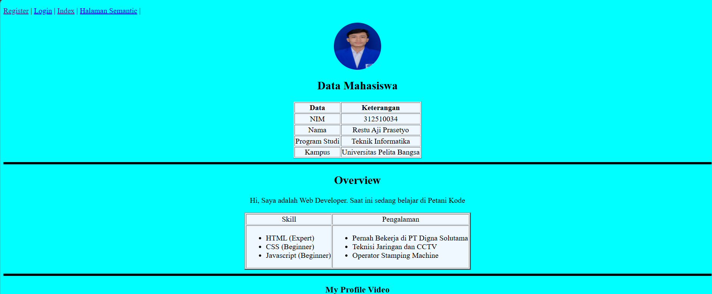
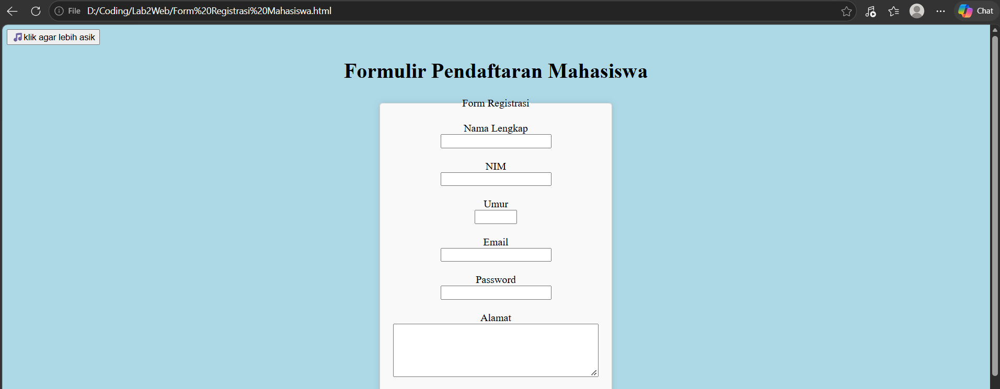
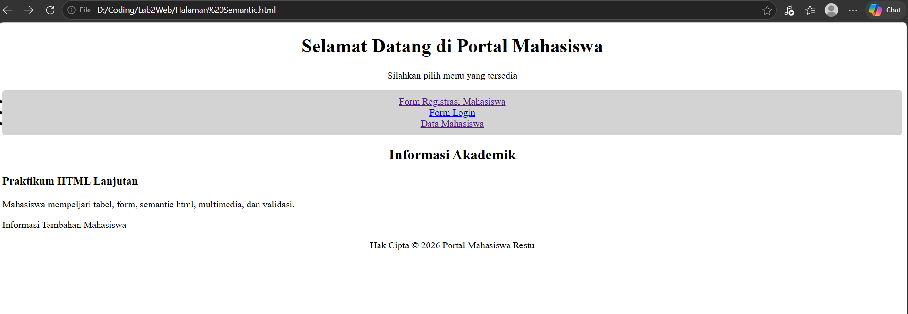
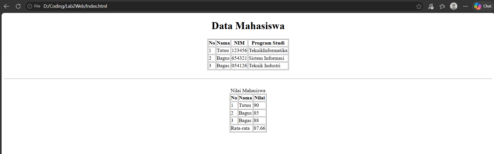
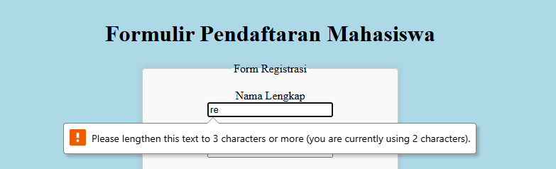
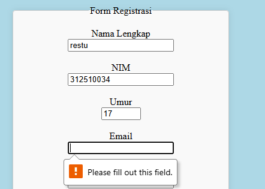
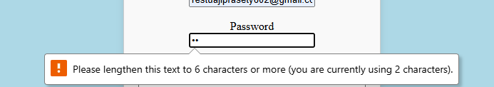
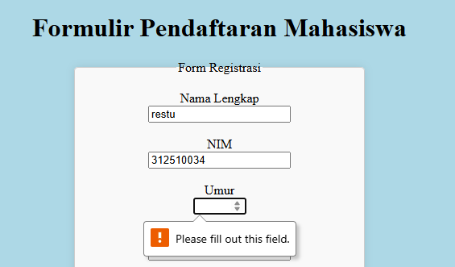
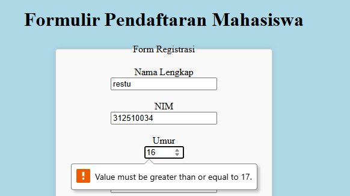

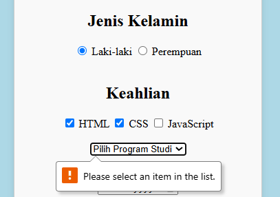
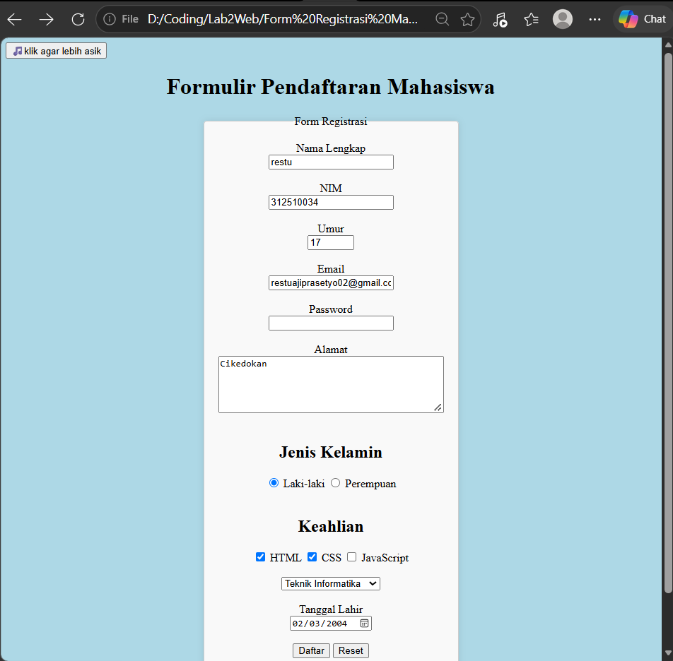
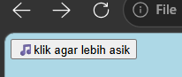
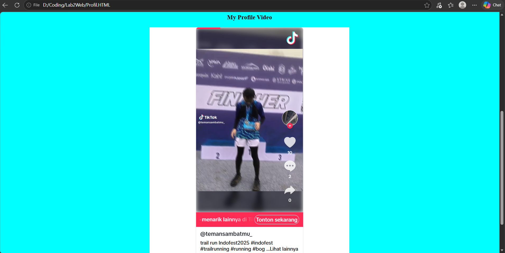

Berikut adalah penjelasan lengkap untuk menjawab kesepuluh pertanyaan mengenai tabel, formulir, elemen semantik, validasi, dan multimedia pada HTML:

---

### 1. Fungsi `<table>`, `<tr>`, `<th>`, dan `<td>`

* **`<table>`**: Tag utama yang berfungsi sebagai wadah atau pembungkus keseluruhan struktur tabel.
* **`<tr>` (Table Row):** Berfungsi untuk mendefinisikan **baris** di dalam tabel.
* **`<th>` (Table Header):** Berfungsi untuk mendefinisikan **sel kepala tabel** (biasanya berisi judul kolom atau baris, teksnya otomatis tebal dan berada di tengah).
* **`<td>` (Table Data):** Berfungsi untuk mendefinisikan **sel data biasa** yang berisi isi atau informasi dari tabel.

---

### 2. Perbedaan `<th>` dan `<td>`

* **`<th>`**: Digunakan khusus untuk sel judul atau header. Secara default, teks di dalam `<th>` ditampilkan dengan **cetak tebal (bold)** dan posisinya berada di tengah (*center*).
* **`<td>`**: Digunakan untuk sel data reguler. Teks di dalamnya berformat **normal** dan rata kiri (*left-aligned*). Selain itu, pembaca layar (*screen reader*) mengidentifikasi `<th>` sebagai penanda konteks bagi data di bawahnya.

---

### 3. Fungsi `colspan` pada Tabel

Atribut `colspan` (kolom span) berfungsi untuk **menggabungkan dua atau lebih kolom horizontal** menjadi satu sel tunggal. Contohnya, `colspan="3"` membuat satu sel melebar dan memakan ruang dari tiga kolom.

---

### 4. Fungsi `<form>` dalam HTML

Tag `<form>` berfungsi sebagai **wadah atau kontainer interaktif** untuk menampung elemen-elemen input pengguna (seperti teks, pilihan, kata sandi, tombol kirim). Form bertugas mengumpulkan data yang diisi oleh pengguna dan mengirimkannya ke server atau skrip pemrosesan.

---

### 5. Perbedaan Radio Button dan Checkbox

* **Radio Button (`<input type="radio">`):** Digunakan ketika pengguna hanya boleh memilih **satu opsi saja** dari sekumpulan pilihan yang saling eksklusif (biasanya berbentuk lingkaran).
* **Checkbox (`<input type="checkbox">`):** Digunakan ketika pengguna boleh memilih **banyak opsi sekaligus** atau tidak sama sekali (bisa memilih nol, satu, atau semua pilihan, biasanya berbentuk kotak centang).

---

### 6. Mengapa `<label>` Sebaiknya Terhubung dengan `id` Input Melalui Atribut `for`?

* **Aksesibilitas & Kegunaan:** Ketika pengguna mengklik teks pada label tersebut, kursor akan otomatis fokus atau mencentang elemen input yang terhubung. Ini sangat membantu pengguna di perangkat seluler dan bagi penyandang disabilitas yang menggunakan pembaca layar (*screen reader*).

---

### 7. Perbedaan `<textarea>` dengan `<input type="text">`

* **`<input type="text">`**: Digunakan untuk memasukkan teks singkat yang **hanya muat dalam satu baris** (contoh: nama lengkap, nomor telepon, kota).
* **`<textarea>`**: Digunakan untuk memasukkan teks yang **panjang dan terdiri dari banyak baris** (contoh: alamat lengkap, kotak komentar, pesan, atau deskripsi). Ukurannya juga bisa diatur tinggi dan lebarnya.

---

### 8. Fungsi Semantic HTML (`<header>`, `<nav>`, `<main>`, `<section>`, `<article>`, `<aside>`, `<footer>`)

Elemen semantik memberikan arti yang jelas mengenai struktur dokumen kepada browser maupun mesin pencari:

* **`<header>`**: Bagian atas halaman atau section (biasanya berisi logo, judul, atau navigasi utama).
* **`<nav>`**: Bagian khusus untuk menu navigasi atau tautan perpindahan halaman.
* **`<main>`**: Konten utama yang paling penting dan unik dari dokumen web tersebut.
* **`<section>`**: Bagian tematik atau bab tersendiri di dalam dokumen.
* **`<article>`**: Konten mandiri yang bisa berdiri sendiri (seperti postingan blog, artikel berita, atau komentar).
* **`<aside>`**: Konten sampingan yang tidak terlalu terkait langsung dengan isi utama (seperti *sidebar*, widget, atau iklan).
* **`<footer>`**: Bagian bawah halaman (biasanya berisi hak cipta, tautan kontak, atau informasi legal).

---

### 9. Fungsi `required`, `min`, `max`, dan `minlength`

* **`required`**: Atribut validasi agar elemen input **wajib diisi** oleh pengguna sebelum form dapat dikirim (*submit*).
* **`min`**: Menentukan **nilai minimum** angka atau tanggal yang diperbolehkan pada input angka/rentang.
* **`max`**: Menentukan **nilai maksimum** angka atau tanggal yang diperbolehkan.
* **`minlength`**: Menentukan **jumlah karakter minimum** yang harus diketik pengguna pada input teks (misalnya minimal 8 karakter untuk password).

---

### 10. Perbedaan Elemen `<audio>` dan `<video>`

* **`<audio>`**: Digunakan untuk menyematkan dan memutar file suara atau musik di halaman web (biasanya dilengkapi kontrol pemutar dasar seperti play, pause, dan volume).
* **`<video>`**: Digunakan untuk menyematkan dan memutar file video, yang tidak hanya memutar suara tetapi juga menampilkan **tampilan visual/gambar bergerak** di layar beserta kontrol pemutarnya.

---